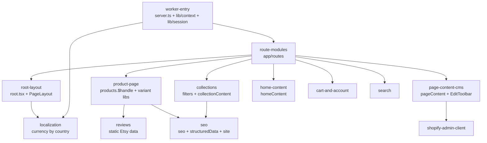

# Codebase map

Catalog of the **modules** in `wood` (CraftWoodFurniture, Shopify Hydrogen storefront). Built by reading code at `10414fa` (incremental update from `eeb4446`, 2026-11-20). Facts are from code; judgement columns (depth) follow the method in [[deepening-candidates]]. Env var names: [[environment-variables]]. External services: [[integrations]].

Not in the diagram: `workers/price-sync.ts` (separate cron Worker), `scripts/*.mjs` (one-off catalogue tooling), `lib/newsletter.server.ts` (no importer found).

| Module               | Path                                                                                                                               | Purpose                                               | Depth                                         | Notes                                  |
| -------------------- | ---------------------------------------------------------------------------------------------------------------------------------- | ----------------------------------------------------- | --------------------------------------------- | -------------------------------------- |
| worker-entry         | `server.ts`, `app/lib/context.ts`, `app/lib/session.ts`, `app/entry.*.tsx`                                                         | fetch handler, Hydrogen context, cookie session       | deep                                          | thin on purpose                        |
| route-modules        | `app/routes/`                                                                                                                      | one file per URL: loader/action/meta/view             | unclear                                       | `products.$handle.tsx` is 1021 lines   |
| root-layout          | `app/root.tsx`, `app/components/PageLayout.tsx`                                                                                    | root loader, analytics, header/footer/aside           | deep                                          |                                        |
| product-page         | `app/routes/products.$handle.tsx` + `app/lib/{variantSelection,variants,upsells,productOptionDisplay,swatches,units,inventory}.ts` | PDP, option/variant resolution, add-ons               | unclear                                       | hot spot, see [[deepening-candidates]] |
| collections          | `app/lib/{collectionFilters,collectionContent,site}.ts`, `CollectionFilters.tsx`                                                   | collection pages, filters, hand-written category copy | unclear                                       |                                        |
| page-content-cms     | `app/lib/{pageContent,pageContent.server,adminCheck.server}.ts`, `api.page-content.tsx`, `EditToolbar*.tsx`, `EditableText.tsx`    | admin inline copy editing via metaobject              | deep                                          | see [[../frontend/edit-toolbar]]       |
| shopify-admin-client | `app/lib/shopifyAdmin.server.ts`                                                                                                   | minimal Admin GraphQL client                          | shallow                                       | one function plus credentials helper   |
| home-content         | `app/lib/homeContent.ts`                                                                                                           | homepage defaults + metaobject merge                  | unclear                                       | see [[../frontend/homepage-content]]   |
| seo                  | `app/lib/{seo,structuredData,site}.ts`, sitemap/robots/llms routes                                                                 | meta, JSON-LD, canonical host, company facts          | deep (seo, structuredData); `site.ts` unclear |                                        |
| localization         | `app/lib/localization.ts`, `routes/localization.tsx`, `CurrencySwitcher.tsx`                                                       | buyer country in session drives currency              | deep                                          |                                        |
| cart-and-account     | `routes/cart*.tsx`, `routes/account*.tsx`, `lib/orderFilters.ts`                                                                   | cart actions, Customer Account API pages              | shallow                                       | mostly Hydrogen template               |
| search               | `lib/search.ts`, `lib/searchSuggestions.ts`, `routes/search.tsx`, `Search*.tsx`                                                    | regular and predictive search                         | shallow                                       | template-derived                       |
| reviews              | `app/data/etsy-*.ts`, `lib/reviews.ts`, `lib/reviewStats.ts`, `ReviewsSection.tsx`                                                 | static Etsy reviews shown on site                     | shallow                                       | data, no live source                   |
| price-sync worker    | `workers/price-sync.ts`, `workers/wrangler.toml`                                                                                   | cron: Google Sheet CSV to Shopify variant prices      | unclear                                       | separate deploy                        |

---

### worker-entry — `server.ts`, `app/lib/`

Purpose: Cloudflare/Oxygen module-format fetch handler; builds the Hydrogen context and commits the session cookie. Domain terms: country session key, storefront redirect.
Interface: `fetch(request, env, ctx)`; throws if `SESSION_SECRET` missing (`context.ts:36`). Invariant: country comes from session, default `GB`.
Depends on: external: Shopify Storefront API (via Hydrogen). Used by: every route (via `context`).

<!-- auto:start module=worker-entry -->

| Function / export                       | File:line                                      | Signature (one line)                          | Does                                                                                 | Called from    |
| --------------------------------------- | ---------------------------------------------- | --------------------------------------------- | ------------------------------------------------------------------------------------ | -------------- |
| default `{fetch}`                       | `server.ts:10`                                 | `fetch(request, env, ctx): Promise<Response>` | apex→www redirect first, then build context, delegate to React Router, commit session, `storefrontRedirect` on 404 | Worker runtime |
| `redirectToCanonicalHost`               | `app/lib/canonicalHost.ts:18`                  | `(request: Request): Response \| null`        | 301 (GET/HEAD) or 308 to `https://www.craftwoodfurniture.co.uk` for host `craftwoodfurniture.co.uk` only; keeps path+query; null otherwise | `server.ts` |
| `createHydrogenRouterContext`           | `app/lib/context.ts:27`                        | `(request, env, executionContext)`            | Hydrogen context with cache, session, i18n country, cart fragment                    | `server.ts`    |
| `AppSession`                            | `app/lib/session.ts:13`                        | `class implements HydrogenSession`            | cookie session                                                                       | `context.ts`   |
| `entry.server.tsx` / `entry.client.tsx` | `app/entry.server.tsx`, `app/entry.client.tsx` | default exports                               | SSR render with CSP, hydrate                                                         | framework      |

<!-- auto:end -->

### route-modules — `app/routes/`

Purpose: file-based routes (`flatRoutes()` in `app/routes.ts`, wrapped by `hydrogenRoutes`). Each file owns its GraphQL query, loader, `meta`, and view.
Interface: loaders read `context.storefront` / `context.env` / `context.customerAccount`; admin-only data additionally requires `isAdminCustomer`.
Depends on: page-content-cms, seo, localization (modules in this file); external: Shopify Storefront API, Customer Account API.

<!-- auto:start module=route-modules -->

| Route / export                                    | File:line                                                                                                                                                                                                                     | Signature (one line)        | Does                                               | Called from               |
| ------------------------------------------------- | ----------------------------------------------------------------------------------------------------------------------------------------------------------------------------------------------------------------------------- | --------------------------- | -------------------------------------------------- | ------------------------- |
| `/` loader, `meta`, `links`, view                 | `routes/_index.tsx:81,38,48,114`                                                                                                                                                                                              | `loader(args)`              | homepage: hero, categories, featured, home content | router                    |
| `/products/:handle` loader, `meta`, `links`, view | `routes/products.$handle.tsx:95,47,43,183`                                                                                                                                                                                    | `loader(args)`              | PDP data, JSON-LD, add-ons                         | router                    |
| `/collections`                                    | `routes/collections._index.tsx:43`                                                                                                                                                                                            | `loader(args)`              | all-collections grid                               | router                    |
| `/collections/all`                                | `routes/collections.all.tsx:33`                                                                                                                                                                                               | `loader(args)`              | all products, locally computed filters             | router                    |
| `/collections/:handle`                            | `routes/collections.$handle.tsx:55`                                                                                                                                                                                           | `loader(args)`              | Shopify-native filters, guide copy                 | router                    |
| `/blogs`, `/blogs/:blog`, `/blogs/:blog/:article` | `routes/blogs._index.tsx:22`, `blogs.$blogHandle._index.tsx:26`, `blogs.$blogHandle.$articleHandle.tsx:45`                                                                                                                    | `loader(args)`              | blog list/article, Article JSON-LD                 | router                    |
| `/pages/:handle`                                  | `routes/pages.$handle.tsx:18`                                                                                                                                                                                                 | `loader(args)`              | Shopify pages                                      | router                    |
| `/pages/favourites`                               | `routes/pages.favourites.tsx:23`                                                                                                                                                                                              | `loader`                    | favourites (client-side list)                      | router                    |
| `/pages/contact`                                  | `routes/pages.contact.tsx:4`                                                                                                                                                                                                  | `loader()`                  | legacy redirect to `/contact`                      | router                    |
| `/about`, `/contact`                              | `routes/about.tsx:43`, `routes/contact.tsx:27`                                                                                                                                                                                | `loader({context,request})` | editable pages                                     | router                    |
| `/landing-oak`                                    | `routes/landing-oak.tsx:104`                                                                                                                                                                                                  | `loader(args)`              | oak landing page                                   | router                    |
| `/policies`, `/policies/:handle`                  | `routes/policies._index.tsx:15`, `policies.$handle.tsx:26`                                                                                                                                                                    | `loader`                    | shop policies                                      | router                    |
| `/search`                                         | `routes/search.tsx:22`                                                                                                                                                                                                        | `loader`                    | search results + predictive                        | router                    |
| `POST /api/page-content`                          | `routes/api.page-content.tsx:26`                                                                                                                                                                                              | `action({request,context})` | intents `ensure-draft`, `save`, `publish`, `reset` | EditToolbar               |
| `GET /api/page-content`                           | `routes/api.page-content.tsx:55`                                                                                                                                                                                              | `loader`                    | read content state (admin gate)                    | EditToolbar               |
| `/localization`                                   | `routes/localization.tsx:18,22`                                                                                                                                                                                               | `action`                    | set buyer country in session                       | CurrencySwitcher          |
| `/cart`                                           | `routes/cart.tsx:14,100`                                                                                                                                                                                                      | `action`, `loader`          | cart mutations, cart read                          | AddToCartButton, CartMain |
| `/cart/:lines`, `/cart/c/*`                       | `routes/cart.$lines.tsx:22`, `routes/cart.c.$.tsx:16`                                                                                                                                                                         | `loader`                    | permalink add-to-cart; cart redirect               | external links            |
| `/discount/:code`                                 | `routes/discount.$code.tsx:15`                                                                                                                                                                                                | `loader`                    | apply discount, redirect                           | external links            |
| `/account*`                                       | `routes/account.tsx:15`, `account.profile.tsx:22,28`, `account.addresses.tsx:34,40`, `account.orders._index.tsx:36`, `account.orders.$id.tsx:14`, `account_.login.tsx:3`, `account_.authorize.tsx:3`, `account_.logout.tsx:9` | `loader`/`action`           | Customer Account API pages and auth                | router                    |
| `/sitemap.xml`, `/sitemap/:type/:page.xml`        | `routes/[sitemap.xml].tsx:4`, `routes/sitemap.$type.$page[.xml].tsx:68`                                                                                                                                                       | `loader`                    | sitemap index and pages                            | crawlers                  |
| `/robots.txt`, `/llms.txt`                        | `routes/[robots.txt].tsx:3`, `routes/[llms.txt].tsx:6`                                                                                                                                                                        | `loader`                    | crawler files                                      | crawlers                  |
| `*`                                               | `routes/$.tsx:3`                                                                                                                                                                                                              | `loader({request})`         | catch-all 404                                      | router                    |

<!-- auto:end -->

### root-layout — `app/root.tsx`, `app/components/`

Purpose: root loader (header/footer queries, GA id, admin flag), layout chrome.
Interface: `shouldRevalidate` limits root reloads; GA only loads if `PUBLIC_GA_MEASUREMENT_ID` set.

<!-- auto:start module=root-layout -->

| Function / export                                     | File:line                           | Signature (one line)       | Does                                                                             | Called from                                                                                      |
| ----------------------------------------------------- | ----------------------------------- | -------------------------- | -------------------------------------------------------------------------------- | ------------------------------------------------------------------------------------------------ |
| `loader`                                              | `app/root.tsx:84`                   | `loader(args)`             | header/footer, env flags                                                         | router                                                                                           |
| `shouldRevalidate`                                    | `app/root.tsx:28`                   | `ShouldRevalidateFunction` | skip needless root reloads                                                       | router                                                                                           |
| `links`                                               | `app/root.tsx:62`                   | `()`                       | preloads self-hosted fonts (`FONT_PRELOADS`, `root.tsx:24`), CSS                 | router                                                                                           |
| `App`                                                 | `app/root.tsx:212`                  | default                    | `<Analytics>`, `PageLayout`                                                      | router                                                                                           |
| `PageLayout`                                          | `components/PageLayout.tsx`         | component                  | Header, Footer, Aside                                                            | `root.tsx`                                                                                       |
| `GoogleAnalytics`                                     | `components/GoogleAnalytics.tsx:44` | component                  | GA4; gtag.js loaded after window `load` + idle, only with analytics consent      | `root.tsx`                                                                                       |
| `editorialCache`                                      | `lib/cache.ts:18`                   | `(storefront)`             | `CacheCustom` public, 60s fresh, 1h stale-while-revalidate for editorial queries | `_index`, blogs routes, `collections._index`, `collections.all`, `collections.$handle` (sidebar) |
| `HEADER_QUERY`, `FOOTER_QUERY`, `CART_QUERY_FRAGMENT` | `lib/fragments.ts:204,263,2`        | string consts              | shared GraphQL                                                                   | `root.tsx`, `context.ts`                                                                         |

<!-- auto:end -->

### product-page — `routes/products.$handle.tsx`, `app/lib/`

Purpose: PDP: gallery, option resolution (length slider, hardware colour swatches), add-ons priced as surcharge variants, JSON-LD. Domain terms: add-on (`addon` tag), slider option, swatch, unit system (metric/imperial), stock limit.
Interface: variant URL params carry options and unit; add-on products are hidden from listings via `-tag:addon`. PDP breadcrumb and JSON-LD `BreadcrumbList` now use the keyword-anchored collection link (via `collectionLinkForHandles`, `PRODUCT_FRAGMENT` fetches `collections(first: 10)` handles), falling back to "Categories" → `/collections/all`; the same pick is computed twice (meta and view).
Depends on: seo, reviews, localization. Used by: `products.$handle.tsx` (all of it).

<!-- auto:start module=product-page -->

| Function / export                                             | File:line                           | Signature (one line)      | Does                                      | Called from                                                                                                                                                                                                |
| ------------------------------------------------------------- | ----------------------------------- | ------------------------- | ----------------------------------------- | ---------------------------------------------------------------------------------------------------------------------------------------------------------------------------------------------------------- |
| `cheapestAvailable`                                           | `lib/variantSelection.ts:34`        | `(…)`                     | pick default variant                      | `products.$handle.tsx`                                                                                                                                                                                     |
| `resolveSelectedOptions`                                      | `lib/variantSelection.ts:70`        | `({…})`                   | selected options from URL                 | `products.$handle.tsx`                                                                                                                                                                                     |
| `unitFromSearchParams`                                        | `lib/variantSelection.ts:118`       | `(…)`                     | unit from query                           | `products.$handle.tsx`                                                                                                                                                                                     |
| `useVariantUrl`, `getVariantUrl`                              | `lib/variants.ts:5,21`              | hook / fn                 | variant URL building                      | ProductForm, ProductItem                                                                                                                                                                                   |
| `buildUpsellGroups`, `filterHiddenProducts`                   | `lib/upsells.ts:62,106`             | fns                       | add-on groups; drop addon-tagged products | PDP, collections, search                                                                                                                                                                                   |
| `ADDON_TAG`, `EXCLUDE_HIDDEN_PRODUCTS_QUERY`                  | `lib/upsells.ts:6,9`                | consts                    | hide add-ons in search queries            | listing routes                                                                                                                                                                                             |
| `isSliderOption`, `compareBySize`                             | `lib/productOptionDisplay.ts:31,45` | fns                       | option rendering rules                    | ProductForm                                                                                                                                                                                                |
| `getSwatchTexture`, `isHardwareColourOption`, `getSwatchTone` | `lib/swatches.ts:47,60,72`          | fns                       | colour swatch images                      | ProductForm                                                                                                                                                                                                |
| `formatMeasurement`                                           | `lib/units.ts:20`                   | `(raw, unit, optionName)` | metric/imperial text                      | ProductForm                                                                                                                                                                                                |
| `getStockLimit`                                               | `lib/inventory.ts:6`                | fn                        | max add-to-cart quantity                  | ProductForm, CartLineItem                                                                                                                                                                                  |
| `useUnitSystem`                                               | `hooks/useUnitSystem.ts:27`         | hook                      | unit toggle state                         | ProductForm, UnitToggle                                                                                                                                                                                    |
| `useFavourites`                                               | `hooks/useFavourites.ts:33`         | hook                      | local favourites                          | `pages.favourites.tsx`                                                                                                                                                                                     |
| `ProductForm`, `ProductModel3D`, `Lightbox`, `ReviewsSection` | `components/`                       | components                | PDP UI                                    | `products.$handle.tsx` (Lightbox also TestimonialsMarquee; `TestimonialsMarquee` swaps `/review-images/` to `/review-images/thumbs/` via local `reviewThumbnail()`, 78x72 tiles, lightbox keeps originals) |

<!-- auto:end -->

### collections — `app/lib/`, `CollectionFilters.tsx`

Purpose: filter URL parsing, local filters for `/collections/all`, hand-written per-category copy and FAQs. Domain terms: category, guide, filter facet. Warning: top-level `products` has no `filters` arg, so `/collections/all` filters locally (see CLAUDE.md).

<!-- auto:start module=collections -->

| Function / export                                                                                                                | File:line                          | Signature (one line)                 | Does                                                                | Called from                                       |
| -------------------------------------------------------------------------------------------------------------------------------- | ---------------------------------- | ------------------------------------ | ------------------------------------------------------------------- | ------------------------------------------------- |
| `parseFiltersFromSearchParams`                                                                                                   | `lib/collectionFilters.ts:14`      | `(URLSearchParams): ProductFilter[]` | URL to Storefront filters                                           | `collections.$handle.tsx`                         |
| `getFilterValueUrl`, `getPriceRangeUrl`, `getClearFiltersUrl`, `isFilterValueActive`, `hasActiveFilters`, `getCurrentPriceRange` | `lib/collectionFilters.ts:50-101`  | fns                                  | filter link building                                                | CollectionFilters                                 |
| `getListAndBooleanFilters`                                                                                                       | `lib/collectionFilters.ts:114`     | `(Filter[])`                         | drops price and availability facets                                 | collection routes                                 |
| `getPriceFilter`, `getPriceBounds`                                                                                               | `lib/collectionFilters.ts:120,125` | fns                                  | price slider bounds                                                 | CollectionFilters                                 |
| `buildLocalFilters`, `applyLocalFilters`                                                                                         | `lib/collectionFilters.ts:151,168` | fns                                  | filters computed in-app                                             | `collections.all.tsx`                             |
| `COLLECTION_CONTENT`                                                                                                             | `lib/collectionContent.ts:50`      | `Record<string, CollectionContent>`  | per-handle intro, specs, FAQ, links, `guides` (new in `eeb4446`); shelves entry gained mantel-match paragraph, link and 2 FAQs (`8349b01`) | `collections.$handle.tsx`, CollectionGuide        |
| `InternalLink`, `COLLECTION_LINKS`, `ALL_COLLECTION_LINKS`, `GUIDE_LINKS`, `ArticleRelatedLinks`, `ARTICLE_RELATED_LINKS`        | `lib/internalLinks.ts:7-49`        | types/consts                         | hand-kept map of internal links between collections and blog guides (committed in `de9658a`; also feeds `BlogIntro`) | `collectionContent.ts`, blog routes, home, Footer |
| `collectionLinkForHandles` | `lib/internalLinks.ts:35` | `(handles: readonly string[]) => InternalLink \| null` | first `ALL_COLLECTION_LINKS` entry whose handle is in the product's Shopify collections; null falls back to `/collections/all` (added `684220b`) | `products.$handle.tsx` (`meta` JSON-LD breadcrumb, view `Breadcrumbs`) |
| `RelatedLinks`                                                                                                                   | `components/RelatedLinks.tsx:5`    | component                            | titled list of internal links                                       | `CollectionGuide`, blog routes                    |
| `HOMEPAGE_CATEGORY_ORDER`, `compareCategories`, `shouldHideCollection`                                                           | `lib/site.ts:103,135,179`           | fns                                  | category order and hiding                                           | home, collections                                 |

<!-- auto:end -->

> [!warning] Working tree vs HEAD (2026-11-20)
> Rows describe HEAD `de9658a` (last checked 2026-11-20); at this sync `app/lib/internalLinks.ts` and `app/components/RelatedLinks.tsx` are tracked in HEAD but missing from the working tree (branch `seo/schema-internal-links`, ~300 uncommitted entries). The working tree on branch `perf/mobile-lcp-cls` differs from HEAD (uncommitted): `app/lib/cache.ts`, `app/styles/tabler-icons-subset.css` and all `public/fonts/*.woff2` show as deleted, and many components/routes modified. Earlier note about `internalLinks.ts`/`RelatedLinks.tsx` no longer applies to this status. Also `public/review-images/thumbs/` is deleted and `reviewThumbnail()` is absent from the working-tree `TestimonialsMarquee.tsx` (HEAD has both). Confirm which state is intended before relying on these rows.

### page-content-cms — `app/lib/`, `EditToolbar*`, `EditableText`

Purpose: admin-only inline editing. Copy lives in a `page_content` metaobject (one entry per page slug), read and written only through the Admin API; `draft_data` vs `published_data`.
Interface: any route reading it must repeat `isAdminCustomer`; slugs in `pageContent.ts`; field ids via `fieldId(...)`. Admin = logged-in Customer Account whose email is in `ADMIN_ALLOWLIST_EMAILS`.
Cache: shopper reads of `published_data` go through `PAGE_CONTENT_CACHE` (`CacheCustom`, public, fresh 60s, stale-while-revalidate 1h, key `['page-content', slug]`); admins bypass and read live, so a Publish shows to shoppers within about a minute.
Depends on: shopify-admin-client; external: Shopify Admin API, Customer Account API. Used by: routes `_index`, `about`, `contact`, `collections._index`, `collections.all`, `pages.favourites`, `products.$handle`, `landing-oak`.

<!-- auto:start module=page-content-cms -->

| Function / export                                                            | File:line                                   | Signature (one line) | Does                             | Called from                                     |
| ---------------------------------------------------------------------------- | ------------------------------------------- | -------------------- | -------------------------------- | ----------------------------------------------- |
| `loadPageContentState`                                                       | `lib/pageContent.server.ts:185`             | `async (…)`          | content + draft state for a slug | the 8 routes above                              |
| `getPageContent`                                                             | `lib/pageContent.server.ts:222`             | `async (…)`          | read content                     | `api.page-content.tsx`                          |
| `ensureDraft`, `saveDraft`, `publishDraft`, `resetDraft`                     | `lib/pageContent.server.ts:230,244,256,270` | async fns            | draft lifecycle                  | `api.page-content.tsx`                          |
| `isAdminCustomer`                                                            | `lib/adminCheck.server.ts:28`               | `async (ctx)`        | allowlist check, per request     | `api.page-content.tsx`, `pageContent.server.ts` |
| `PageContentMap`, `PageContentState`, `EMPTY_PAGE_CONTENT`, slugs, `fieldId` | `lib/pageContent.ts:11,24,38-55`            | types/consts         | shared shapes                    | server + client                                 |
| `EditToolbar`, `EditToolbarProvider`, `EditableText`, `ConfirmDialog`        | `components/`                               | components           | toolbar and editable fields      | 8 routes; 13 components use `EditableText`      |

<!-- auto:end -->

### shopify-admin-client — `app/lib/shopifyAdmin.server.ts`

Purpose: Admin GraphQL helper, API version `2026-04`. Returns `null` credentials when unconfigured so pages degrade instead of 500.

<!-- auto:start module=shopify-admin-client -->

| Function / export     | File:line                       | Signature (one line)              | Does                | Called from             |
| --------------------- | ------------------------------- | --------------------------------- | ------------------- | ----------------------- |
| `adminCredentials`    | `lib/shopifyAdmin.server.ts:25` | `(env): AdminCredentials \| null` | token + shop domain | `pageContent.server.ts` |
| `shopifyAdminGraphQL` | `lib/shopifyAdmin.server.ts:32` | `async <T>(…)`                    | POST Admin GraphQL  | `pageContent.server.ts` |

<!-- auto:end -->

### home-content — `app/lib/homeContent.ts`

Purpose: homepage copy defaults merged with metaobject values. Interface: `HOME_CONTENT_DEFAULTS` is the fallback; `HOME_CONTENT_QUERY` fetches overrides.

<!-- auto:start module=home-content -->

| Function / export       | File:line                | Signature (one line) | Does                            | Called from         |
| ----------------------- | ------------------------ | -------------------- | ------------------------------- | ------------------- |
| `HOME_CONTENT_DEFAULTS` | `lib/homeContent.ts:77`  | `HomeContent`        | default copy                    | `buildHomeContent`  |
| `buildHomeContent`      | `lib/homeContent.ts:223` | `(…)`                | merge defaults and Shopify data | `routes/_index.tsx` |
| `HOME_CONTENT_QUERY`    | `lib/homeContent.ts:289` | `#graphql` string    | metaobject query                | `routes/_index.tsx` |

<!-- auto:end -->

### seo — `app/lib/{seo,structuredData,site}.ts`

Purpose: canonical URLs, titles, JSON-LD, company facts. `isPublicHost` separates the public host from preview hosts (used in `entry.server.tsx`).

<!-- auto:start module=seo -->

| Function / export                                                                                                                                                 | File:line                          | Signature (one line) | Does                                                                       | Called from                                                               |
| ----------------------------------------------------------------------------------------------------------------------------------------------------------------- | ---------------------------------- | -------------------- | -------------------------------------------------------------------------- | ------------------------------------------------------------------------- |
| `getCanonicalUrl`, `toMetaDescription`, `toPageTitle`, `seoMeta`                                                                                                  | `lib/seo.ts:9,18,34,61`            | fns                  | meta tags                                                                  | route `meta` functions                                                    |
| `organizationJsonLd`, `websiteJsonLd`, `breadcrumbJsonLd`, `collectionPageJsonLd`, `aboutPageJsonLd`, `blogJsonLd`, `faqJsonLd`, `productJsonLd`, `articleJsonLd` | `lib/structuredData.ts:11-223`     | fns                  | schema.org JSON-LD (`aboutPageJsonLd`, `blogJsonLd` and stable Organization `@id` added in `6916ef8`; used by `about`, `blogs._index` (CollectionPage), `blogs.$blogHandle._index` (Blog))  | route views (`about`, `blogs._index`, `blogs.$blogHandle._index`, others) |
| `getDescriptionSummary`                                                                                                                                           | `lib/description.ts:7`             | `(html)`             | plain-text summary                                                         | PDP, SEO                                                                  |
| `isPublicHost`, `COMPANY`, `SOCIAL_LINKS`, `ETSY_SHOP_URL` (`site.ts:91`; added `324e699`, feeds Organization `sameAs` and `/llms.txt` "Names and other channels"), `FLAGSHIP_PAGE_ROUTES`, `getPagePath`, `getFlagshipPagePath`                                                           | `lib/site.ts:13,19,55,141,169,175` | fns/consts           | site constants                                                             | many                                                                      |

<!-- auto:end -->

### localization — `app/lib/localization.ts`

Purpose: buyer country in session drives `@inContext` currency. Default `GB`.

<!-- auto:start module=localization -->

| Function / export                                              | File:line                      | Signature (one line) | Does                        | Called from               |
| -------------------------------------------------------------- | ------------------------------ | -------------------- | --------------------------- | ------------------------- |
| `resolveCountry`                                               | `lib/localization.ts:88`       | fn                   | validate submitted country  | `routes/localization.tsx` |
| `currencyOptions`, `activeCurrency`                            | `lib/localization.ts:46,68`    | fns                  | switcher data               | Header, CurrencySwitcher  |
| `COUNTRY_SESSION_KEY`, `DEFAULT_COUNTRY`, `LOCALIZATION_ROUTE` | `lib/localization.ts:17,20,22` | consts               | session key, default, route | `context.ts`, switcher    |

<!-- auto:end -->

### cart-and-account, search, reviews

<!-- auto:start module=other -->

| Function / export                                                                         | File:line                                   | Signature (one line)                       | Does                        | Called from                                                                                                                |
| ----------------------------------------------------------------------------------------- | ------------------------------------------- | ------------------------------------------ | --------------------------- | -------------------------------------------------------------------------------------------------------------------------- |
| `buildOrderSearchQuery`, `parseOrderFilters`                                              | `lib/orderFilters.ts:39,72`                 | fns                                        | order list filtering        | `account.orders._index.tsx`                                                                                                |
| `urlWithTrackingParams`, `getEmptyPredictiveSearchResult`                                 | `lib/search.ts:63,25`                       | fns                                        | search result links         | search components                                                                                                          |
| `buildFeaturedSearchProducts`, `SEARCH_SUGGESTIONS_QUERY`                                 | `lib/searchSuggestions.ts:10,17`            | fn/const                                   | empty-state suggestions     | SearchSuggestions                                                                                                          |
| `redirectIfHandleIsLocalized`                                                             | `lib/redirect.ts:3`                         | fn                                         | redirect localized handles  | `pages.$handle`, `collections.$handle`, `products.$handle`, `blogs.$blogHandle._index`, `blogs.$blogHandle.$articleHandle` |
| `ETSY_PRODUCT_REVIEWS`, `ETSY_HOME_REVIEWS`, `ETSY_SHOP_RATING`, `ETSY_RATINGS_BY_HANDLE` | `app/data/etsy-*.ts`                        | static data                                | reviews and ratings         | PDP, home, `site.ts`                                                                                                       |
| `HOMEPAGE_REVIEWS`, `formatReviewCount`                                                   | `lib/reviews.ts:5`, `lib/reviewStats.ts:13` | const/fn                                   | review display              | ReviewsSection                                                                                                             |
| `subscribeEmailToNewsletter` (+ 2 helpers)                                                | `lib/newsletter.server.ts:50`               | `async ({adminToken, storeDomain, email})` | Admin API marketing consent | **no importer found**                                                                                                      |
| `shopifyImageUrl`, `shopifySrcSet`                                                        | `lib/shopifyImage.ts:7,15`                  | fns                                        | CDN width/srcset            | HeroCarousel, CategoryCard                                                                                                 |
| `cn`                                                                                      | `lib/utils.ts:4`                            | fn                                         | class merge                 | components                                                                                                                 |

<!-- auto:end -->

Note (2026-11-23, `a290904`): `CartSummary.tsx` gift-card form is now wrapped in a `
` and the subtotal note reads "Free UK delivery on every order" (copy only, no interface change); `app.css` widens `.wrap`-style containers to 1400px with 40px padding (footer rows 20px on mobile).

### price-sync worker — `workers/price-sync.ts`

Purpose: separate Worker, cron `* * * * *`, downloads a Google Sheet as CSV and updates Shopify variant prices via Admin API (`2025-01`). Interface: `scheduled`, `fetch` handlers; needs `SHOPIFY_ADMIN_TOKEN`, `GOOGLE_SHEET_ID`; shop domain hardcoded in file.

<!-- auto:start module=price-sync -->

| Function / export            | File:line                   | Signature (one line) | Does                      | Called from     |
| ---------------------------- | --------------------------- | -------------------- | ------------------------- | --------------- |
| default `{scheduled, fetch}` | `workers/price-sync.ts:146` | handlers             | cron sync, manual trigger | Cloudflare cron |

<!-- auto:end -->

### scripts — `scripts/*.mjs`

One-off catalogue tooling (Etsy import, Shopify CSV, metafield and metaobject setup, price/inventory fixes, publish to channel). Not part of the runtime. TODO: unknown which are still current.

## npm scripts

`build`, `dev`, `preview`, `lint`, `typecheck`, `codegen` (see `package.json`).
